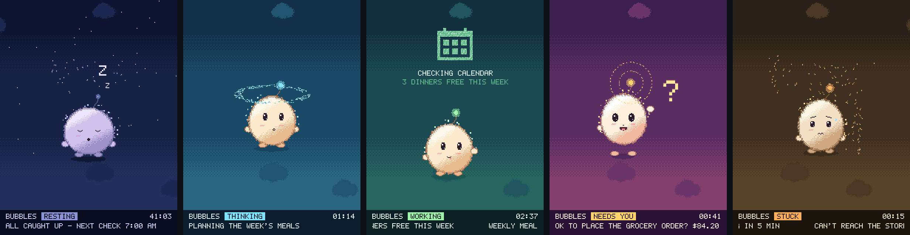
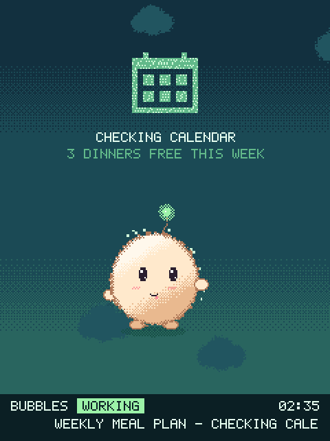
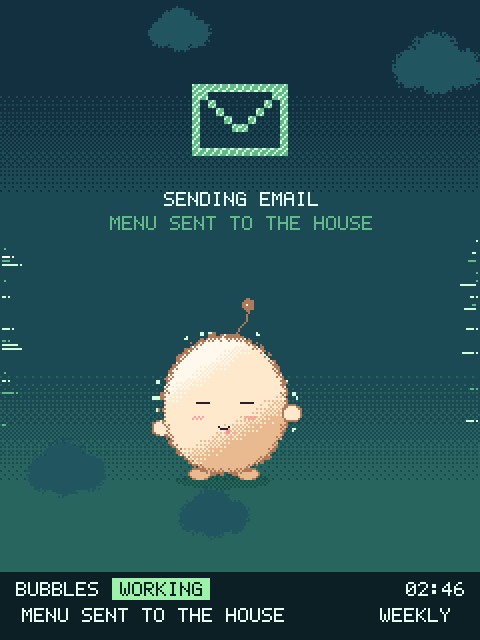
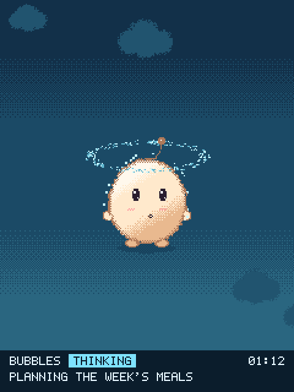

<h1 align="center">bubble-screen</h1>

<p align="center">
  <b>A tiny desk buddy that shows what your AI agent is up to.</b><br>
  A $15 ESP32 screen, a pixel-cloud character, and your <a href="https://github.com/paperclipai/paperclip">Paperclip</a> agent's every move.
</p>

<p align="center">
  <a href="LICENSE"></a>
  
  
  
  
</p>

<p align="center">
  
</p>

Your agent is off booking appointments, filling grocery carts and answering email while you get on with your day.
**bubble-screen** puts it on your desk as a little character who thinks, works, naps, waves at you when it needs a
decision, and gets visibly flustered when something breaks. Other agents in the company show up as helpers who run
off-screen with the work and pop back to whisper the results.

Everything above is real firmware output. The GIFs are rendered by the device's own drawing code
([`tools/render`](tools/render)), not mockups.

---

## What it does

### Five moods, readable from across the room

<p align="center"></p>

| | When |
|---|---|
| **Resting** | Nothing running. Dozes under the stars and shows how many things are waiting on you. |
| **Thinking** | A run is going, but no tool is in use. A halo of motes circles his head. |
| **Working** | A tool call in the last 15 seconds. Motes build a picture of the job (calendar, list, cart, envelope), with the task underneath. |
| **Needs you** | The agent asked you something in the last 48 hours. He hops, waves, and his antenna pulses gold. |
| **Stuck** | The last run failed. Warm amber, worried brows, a sweat drop. |

### Helpers do the legwork off-screen

When another agent in the company picks up work, he tosses it a work order off the side of the screen and that edge
starts fizzing. When the helper finishes, it pops in and whispers the result in his ear: the first line of the
comment its run posted. Helpers are **sized by model**: Opus helpers are twice the size of Sonnet ones.

<table align="center">
  <tr>
    <td align="center"><br><sub>Hand-off: the edges fizz while helpers work</sub></td>
    <td align="center"><br><sub>Pop-in: the helper whispers the result</sub></td>
  </tr>
</table>

### It's touchy-feely

<table align="center">
  <tr>
    <td align="center"><br><sub>Rub or tap to tickle</sub></td>
    <td align="center"><br><sub>Hold still to pet</sub></td>
  </tr>
</table>

Touch anywhere else and his eyes and the motes follow your finger.

### Near-realtime

The service listens to Paperclip's live event feed, and the display long-polls, so a new run, a finished helper or a
question for you shows up in about a second. No refresh button, no polling lag.

### Demo mode: meet BUBBLES

With no service configured, the screen runs a demo starring **BUBBLES** (and a couple of BUBBLES helpers). Plug it
in at a party and it just works.

---

## Why it's buttery

- **No UI framework.** A hand-written ILI9341 driver streams 16-row strips over DMA SPI at 80 MHz, while plain C draws
  into an 8-bit, 99-colour framebuffer. That's about 13 ms to draw and 16 ms to send: a locked **30 fps**. LVGL on the
  same board managed about 12.
- **The network can't drop a frame.** Wi-Fi and HTTP run on the other core. The renderer only reads a snapshot behind
  a spinlock.
- **Boots in under half a second.** The first frame is up before Wi-Fi even starts.
- **Battle scars, written down.** [`docs/ARCHITECTURE.md`](docs/ARCHITECTURE.md) covers the heap that can't hold two
  framebuffers, the `sinf` slow path that kicks in two minutes after boot, and the `micros()` clock that wraps every
  71 minutes.

---

## What you need

| Part | Notes |
|---|---|
| **ESP32-2432S028R** "Cheap Yellow Display" | 2.8" 240×320 ILI9341 with XPT2046 touch. About $15. Stand it upright. |
| A USB cable that carries data | Plenty of them only carry power. If nothing shows up on USB, swap the cable first. |
| A Paperclip instance | For live mode. Demo mode needs nothing. |
| Somewhere to run the service | Any box on your LAN with Docker or Python 3.12. |

## Quick start

**1. Flash the firmware** ([PlatformIO](https://platformio.org)):

```bash
pio run -t upload        # the board shows BUBBLES right away
```

Prebuilt images are on the [releases page](../../releases). With
[esptool](https://github.com/espressif/esptool): `esptool.py --chip esp32 write_flash 0x0 bubble-screen-<version>.bin`.

**2. Run the service** next to your Paperclip:

```bash
cd service && cp .env.example .env    # fill in the API base, the agent key, ids, and a device password
docker compose -f deploy/compose.yml up -d --build
```

See [`service/deploy/README.md`](service/deploy/README.md) for the details, including how to mint a key for your agent.

**3. Point the screen at it** (serial, 115200 baud; every setting is saved on the board):

```
set ssid <wifi name>
set pass <wifi password>
set host <service ip>
set port 8000
set psk <DEVICE_PSK>
live
```

That's it. Your agent's name shows up in the corner, and the character starts living its life.

### Serial commands

| Command | Effect |
|---|---|
| `live` / `demo` | Choose the source (saved). |
| `sleep` `think` `work` `ask` `error` | Pin a state, for testing. |
| `helpers` | Play the helper demo once. |
| `set host\|port\|psk\|ssid\|pass <value>` | Configure (saved). |
| `invert` | Flip colour inversion. Some CYD panels need it: if dark looks washed out, try this. |
| `flip` | Rotate 180°. |
| `skew <s>` | Jump the clock ahead (tests the clock rebase). |

---

## How it works

```
 display ──HTTP long-poll, LAN──▶ bubble-screen service ──HTTPS, GET only──▶ Paperclip API
                                          ▲
                                          └── Paperclip live events (WebSocket, receive-only)
```

- **Read-only by construction.** The service uses the agent's own API key and a client that refuses anything but GET.
  The display only ever holds a device password that unlocks one endpoint.
- **One status, five states,** picked in priority order (ask, stuck, working, thinking, resting) from runs, the run
  log tail, open questions and approvals.
- **Helpers** are the other agents in the company: `working` while running, `done` for two minutes after, whispering
  the comment their run posted.

The full tour, with the ESP32 lessons, is in [`docs/ARCHITECTURE.md`](docs/ARCHITECTURE.md).

## Hacking on it

```bash
cd service && python -m venv .venv && .venv/bin/pip install -r requirements.txt -r requirements-dev.txt
.venv/bin/python -m pytest -q                          # service tests

# Re-render every GIF in this README from the firmware's drawing code:
g++ -std=gnu++17 -O2 -DBUBBLE_HOST -Itools/render/shim -Isrc tools/render/render.cpp -o /tmp/bubble-render
mkdir -p /tmp/frames && /tmp/bubble-render /tmp/frames && python3 tools/render/make_media.py /tmp/frames docs/media
```

The renderer compiles `src/main.cpp` for your PC, with the hardware stubbed out, and plays scripted scenes at 30 fps.
It's also handy for trying out new animations without flashing anything.

## License

Copyright (C) 2026 Nick Allevato <nick.allevato@gmail.com>

bubble-screen is free software: you can redistribute it and/or modify it under the terms of the GNU General Public
License, version 3, as published by the Free Software Foundation. It comes with ABSOLUTELY NO WARRANTY. See
[LICENSE](LICENSE) for the full text.
